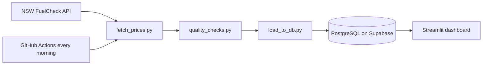

# sydney-fuel-pipeline

“History begins 5 Nov 2026, when the pipeline first ran. The first load contains each station’s latest price at that point, so earlier dates are not full history.”

# Sydney Fuel Price Pipeline

Live dashboard: https://sydney-fuel-pipeline-qh8kenfjknddecjn3u4yym.streamlit.app/

## What it does

Every morning, this project collects fuel prices for all of NSW from the government FuelCheck API. It checks the data, then saves it to a database. It keeps every price change, so I can see how prices move over time and not just what they are today.

## Why I built it

Most fuel apps only show today's price. I wanted to keep the history so I could look for patterns. It also let me practise building a data pipeline that runs on its own without me.

## How it works

1. **Fetch:** gets a login token, then pulls all stations and prices.
2. **Check:** stops the run if the data looks wrong.
3. **Load:** saves new prices into two tables, `stations` and `prices`.
4. **Show:** a Streamlit dashboard reads the database.
5. **Automate:** GitHub Actions runs steps 1 to 3 every morning.

## Tools

Python, SQL, PostgreSQL (Supabase), GitHub Actions, Streamlit, pandas.

## Problems I ran into

- **Odd prices in my quality check.** My first check flagged 902 prices as wrong. They were EV charging prices, which use different units from petrol. I changed the check to use a separate price range for each fuel type.
- **Duplicates.** Each price is identified by station, fuel type and update time. Running the loader twice adds nothing new, so it is safe to re-run.
- **A failed first run on GitHub.** The automated run failed with a 401 error. The fix was re-entering my secrets in GitHub without extra characters.
- **Keeping keys safe.** API keys and the database password live in a `.env` file and GitHub Secrets. They are never in the code.

## What I found

FILL IN with 2 or 3 real findings after a week of data. For example, which suburbs are cheapest and which day of the week prices change most.

## Limits

- History starts on 5 Nov 2026. Earlier dates in the data come from each station's latest price on the first load.
- "Cheapest right now" uses each station's newest price, even if it is old.
- The trend chart shows the average of prices that changed each day, not the average across all stations.

## What I would do next

- Ignore prices that have not updated in 14 days.
- Rebuild the full price level for each day to make the trend more accurate.
- Add alerts when the pipeline fails.

## Run it yourself

1. Get a free key at api.nsw.gov.au.
2. Create a `.env` file with `FUEL_API_KEY`, `FUEL_API_SECRET` and `DATABASE_URL`.
3. Run the `schema.sql` file in your database.
4. Run `python fetch_prices.py`, then `quality_checks.py`, then `load_to_db.py`.
5. Run `streamlit run dashboard/app.py`.